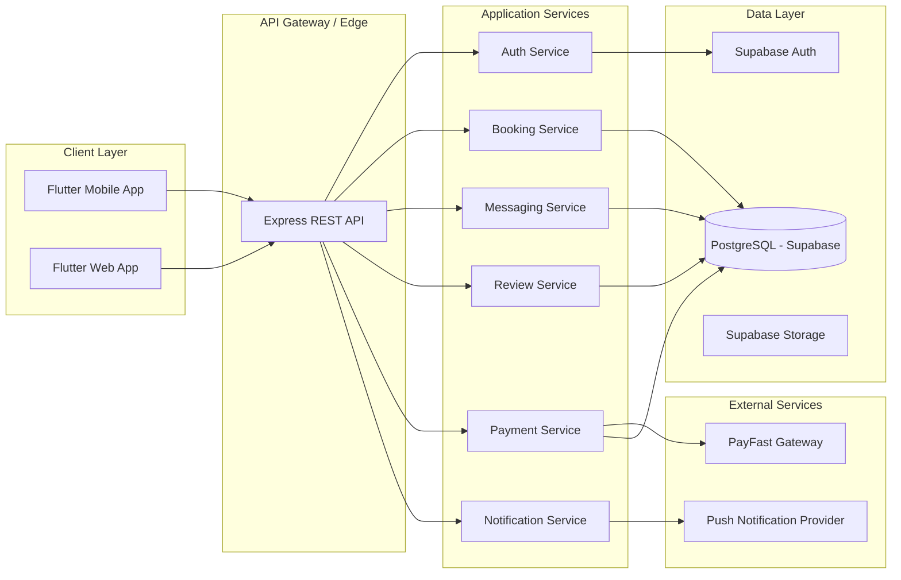

# ConnectLocal

**A location-based service marketplace connecting customers with trusted local service providers.**

[](.github/workflows/backend-ci.yml)
[](.github/workflows/frontend-ci.yml)
[](LICENSE)

> Final-Year BSc Information Technology Software Engineering Project

---

## 1. Project Overview

ConnectLocal is a mobile and web platform that connects customers with nearby, verified local service providers such as plumbers, electricians, tutors, hairdressers, mechanics, and cleaning services. The platform addresses the widespread problem of discovering, vetting, booking, and paying trusted local service providers by combining geolocation search, in-app booking, secure messaging, reviews, and integrated payments in a single ecosystem.

The system is composed of a Flutter cross-platform client, a Node.js/Express REST API backend, and a PostgreSQL database managed through Supabase. The client renders maps with Flutter map tooling; the backend stores coordinates and runs nearby search with PostGIS. PayFast handles local payment processing.

This repository contains the full software engineering documentation set (requirements, architecture, database design, API specifications, project management artifacts, testing strategy, and deployment guides) alongside the application source code scaffolding, produced to a standard suitable for academic assessment and industry review.

## 2. Features

### Customer Features
- Registration and login (Email, Phone, Google OAuth)
- Email and phone verification
- Nearby provider search and map markers using client-rendered Flutter maps and PostGIS
- Provider profile and service browsing
- Booking creation, rescheduling, and cancellation
- In-app real-time messaging with providers
- Ratings and reviews
- Push and in-app notifications
- Secure payments via PayFast

### Provider Features
- Business profile registration and identity verification
- Service catalogue management (pricing, categories, descriptions)
- Availability and calendar management
- Booking acceptance/rejection workflow
- Customer messaging
- Payment receipt and payout tracking
- Review visibility and response

### Administrator Features
- User and provider account management
- Provider verification/approval workflow
- Review moderation
- Dispute resolution
- Platform analytics dashboard
- System configuration management

## 3. Architecture Overview

ConnectLocal follows a **layered, service-oriented architecture** with a mobile-first client, a stateless REST API layer, and a managed relational database with row-level security.



See [`docs/architecture/System-Architecture.md`](docs/architecture/System-Architecture.md) for the full architectural specification.

## 4. Tech Stack

| Layer | Technology | Justification |
|---|---|---|
| Frontend (Mobile & Web) | Flutter (Dart) | Single codebase for iOS, Android, and Web; strong performance; rich widget ecosystem |
| Backend | Node.js + Express | Non-blocking I/O suited to high-concurrency booking/messaging workloads; large ecosystem |
| Database | PostgreSQL (via Supabase) | ACID-compliant relational integrity for bookings/payments; native PostGIS support for geolocation |
| Authentication | Supabase Auth | Built-in email/phone/OAuth flows with JWT issuance, reducing custom auth surface area |
| Maps & Geolocation | Flutter map renderer + PostGIS | Map tiles are rendered client-side; provider coordinates and radius search stay in the API/database |
| Payments | PayFast | Leading South African payment gateway supporting card, EFT, and instant EFT |
| Hosting | Supabase (DB/Auth/Storage) + Render (API hosting) | Managed infrastructure reduces DevOps overhead for a small team |
| CI/CD | GitHub Actions | Native integration with repository, free tier sufficient for project scale |

## 5. Folder Structure

```
connectlocal/
├── docs/                      # All project documentation
│   ├── architecture/
│   ├── requirements/
│   ├── api-specs/
│   ├── meeting-notes/
│   ├── sprint-plans/
│   ├── project-management/
│   ├── testing/
│   └── deployment/
├── frontend/                  # Flutter application
├── backend/                   # Node.js/Express API
├── database/                  # Schema, migrations, seed scripts
├── diagrams/                  # Mermaid/UML diagrams
│   ├── erd/
│   ├── use-cases/
│   ├── sequence/
│   ├── activity/
│   └── architecture/
├── assets/                    # Branding, wireframes, mockups
│   ├── branding/
│   ├── wireframes/
│   └── mockups/
├── .github/
│   ├── workflows/
│   └── ISSUE_TEMPLATE/
├── README.md
├── CONTRIBUTING.md
├── LICENSE
└── .gitignore
```

## 6. Getting Started

### Prerequisites
- Node.js >= 18.x and npm >= 9.x
- Flutter SDK >= 3.19.x
- A Supabase project (PostgreSQL + Auth + Storage)
- PostGIS enabled in the Supabase project (the backend migration enables it when permitted)
- PayFast merchant sandbox credentials
- Git

### Installation

```bash
# 1. Clone the repository
git clone https://github.com/connectlocal/connectlocal.git
cd connectlocal

# 2. Backend setup
cd backend
npm install
cp .env.example .env    # populate environment variables (see below)
npm run dev

# 3. Frontend setup
cd ../frontend
flutter pub get
flutter run
```

### Environment Variables

Backend (`backend/.env`):

```
PORT=4000
NODE_ENV=development

# Supabase
SUPABASE_URL=https://<project>.supabase.co
SUPABASE_SERVICE_ROLE_KEY=<service-role-key>
SUPABASE_ANON_KEY=<anon-key>

# Database (direct connection, for migrations)
DATABASE_URL=postgresql://<user>:<password>@<host>:5432/<database>

# JWT
JWT_SECRET=<generated-secret>
JWT_EXPIRY=1h
REFRESH_TOKEN_EXPIRY=30d

# PayFast
PAYFAST_MERCHANT_ID=<merchant-id>
PAYFAST_MERCHANT_KEY=<merchant-key>
PAYFAST_PASSPHRASE=<passphrase>
PAYFAST_MODE=sandbox

# Notifications
FCM_SERVER_KEY=<firebase-cloud-messaging-key>
```

Frontend (`frontend/.env`):

```
API_BASE_URL=https://api.connectlocal.dev
SUPABASE_URL=https://<project>.supabase.co
SUPABASE_ANON_KEY=<anon-key>
```

## 7. Contribution Guide

Please read [CONTRIBUTING.md](CONTRIBUTING.md) for branch naming, commit conventions, the pull request process, and coding standards before contributing.

### Branch Strategy

ConnectLocal uses a **GitHub Flow with release branches** model:

| Branch | Purpose |
|---|---|
| `main` | Production-ready, always deployable |
| `develop` | Integration branch for the current sprint |
| `feature/*` | New features, branched from `develop` |
| `bugfix/*` | Non-critical fixes, branched from `develop` |
| `hotfix/*` | Urgent production fixes, branched from `main` |
| `release/*` | Release stabilization branches |

## 8. Roadmap

| Milestone | Target | Scope |
|---|---|---|
| M1 — Foundations | Sprint 1–2 | Database schema, authentication, project setup |
| M2 — Core Marketplace | Sprint 3–4 | Provider profiles, search, service listings |
| M3 — Transactions | Sprint 5–6 | Bookings, messaging, notifications |
| M4 — Trust & Payments | Sprint 7–8 | Reviews, payments, admin dashboard |
| M5 — Hardening | Sprint 9–10 | Testing, performance, security audit |
| M6 — Release | Sprint 11 | Deployment, UAT, final report |

## 9. Team Structure

| Role | Responsibility |
|---|---|
| Project Lead / Backend Developer | Architecture, API development, database design |
| Frontend Developer | Flutter application development |
| QA / Test Engineer | Test strategy, test case authoring, execution |
| UI/UX Designer | Wireframes, mockups, branding |
| Academic Supervisor | Project oversight and assessment |

## 10. License

This project is licensed under the MIT License — see [LICENSE](LICENSE) for details.
