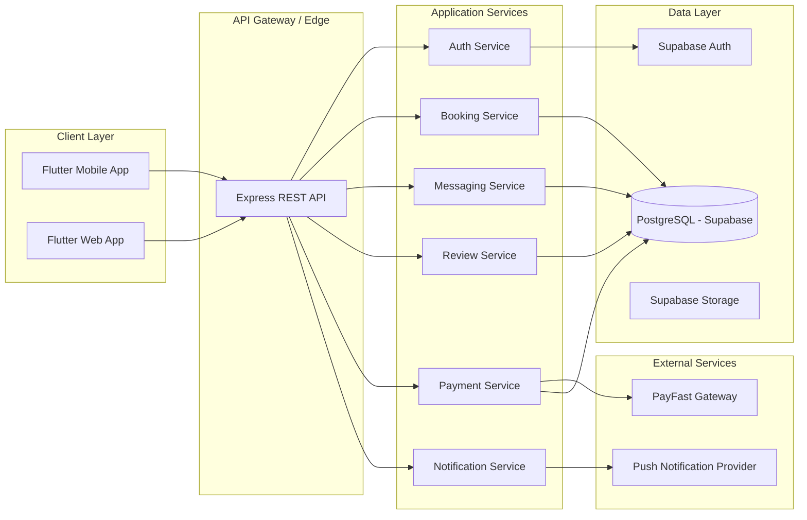

# ConnectLocal

**A location-based service marketplace connecting customers with trusted local service providers.**

[](.github/workflows/backend-ci.yml)
[](.github/workflows/frontend-ci.yml)
[](LICENSE)

> Final-Year BSc Information Technology Software Engineering Project

---

## 1. Project Overview

ConnectLocal is a mobile and web platform that connects customers with nearby, verified local service providers such as plumbers, electricians, tutors, hairdressers, mechanics, and cleaning services. The platform addresses the widespread problem of discovering, vetting, booking, and paying trusted local service providers by combining geolocation search, in-app booking, secure messaging, reviews, and integrated payments in a single ecosystem.

The system is composed of a Flutter cross-platform client, a Node.js/Express REST API backend, and a PostgreSQL database managed through Supabase. The client renders maps with Flutter map tooling; the backend stores coordinates and runs nearby search with PostGIS. PayFast handles local payment processing.

This repository contains the full software engineering documentation set (requirements, architecture, database design, API specifications, project management artifacts, testing strategy, and deployment guides) alongside the application source code scaffolding, produced to a standard suitable for academic assessment and industry review.

## 2. Features

### Customer Features
- Sign-up as "I need a service" (customer) or "I offer a service" (provider); email login
- Email and phone verification (6-digit code, no paid SMS) before booking
- Nearby provider search and map markers using client-rendered Flutter maps and PostGIS
- Provider profile and service browsing
- Booking a time slot (visit the business or house call), rescheduling and cancellation
- 15% booking fee by card (counts toward the price), arrival PIN, balance by card or cash
- In-app real-time messaging with providers
- Ratings and reviews
- Push and in-app notifications
- Secure payments via PayFast

### Provider Features
- Business application (registration number + documents) approved by the admin
- Bank details (stored encrypted) and automatic payouts (10% ConnectLocal commission)
- Services priced per hour, fixed, or as packages
- Working hours and slot length (30 min to 8 hours)
- Booking acceptance/rejection workflow
- Customer messaging
- Payment receipt and payout tracking
- Review visibility and response

### Administrator Features
- User and provider account management
- Provider verification/approval workflow
- Review moderation
- Dispute resolution
- Platform analytics dashboard
- System configuration management

## 3. Architecture Overview

ConnectLocal follows a **layered, service-oriented architecture** with a mobile-first client, a stateless REST API layer, and a managed relational database with row-level security.



See [`docs/architecture/System-Architecture.md`](docs/architecture/System-Architecture.md) for the full architectural specification.

## 4. Tech Stack

| Layer | Technology | Justification |
|---|---|---|
| Frontend (Mobile & Web) | Flutter (Dart) | Single codebase for iOS, Android, and Web; strong performance; rich widget ecosystem |
| Backend | Node.js + Express | Non-blocking I/O suited to high-concurrency booking/messaging workloads; large ecosystem |
| Database | PostgreSQL (via Supabase) | ACID-compliant relational integrity for bookings/payments; native PostGIS support for geolocation |
| Authentication | Supabase Auth | Built-in email/phone/OAuth flows with JWT issuance, reducing custom auth surface area |
| Maps & Geolocation | Flutter map renderer + PostGIS | Map tiles are rendered client-side; provider coordinates and radius search stay in the API/database |
| Payments | PayFast | Leading South African payment gateway supporting card, EFT, and instant EFT |
| Hosting | Supabase (DB/Auth/Storage), Netlify (web builds), API in Codespaces for the demo | Managed infrastructure reduces DevOps overhead for a small team |
| CI/CD | GitHub Actions | Native integration with repository, free tier sufficient for project scale |

## 5. Folder Structure

```
connectlocal/
├── backend/                   # Node.js/Express API (ES modules)
│   ├── server.js              #   starts src/app.js
│   ├── src/
│   │   ├── routes/            #   /api/v1/{auth,users,providers,search,bookings,messages,reviews,payments,admin,notifications,uploads,geo}
│   │   ├── services/          #   business rules (who may do what, booking flow, payments)
│   │   ├── repositories/      #   all database access (Supabase service role)
│   │   ├── middleware/        #   auth (token + role), validation, rate limits, errors
│   │   ├── integrations/      #   PayFast, Storage, payouts, maps
│   │   └── utils/             #   validators.js (same rules as the app), schedule.js (time slots)
│   ├── tests/                 #   jest unit + integration tests
│   └── scripts/               #   smoke-test.sh, e2e-booking-flow.mjs, db-push.mjs, codespace-port-public.sh
├── frontend/connect-local/    # Flutter app
│   ├── lib/main.dart          #   customer + provider app
│   ├── lib/main_admin.dart    #   separate admin web app
│   ├── lib/core/              #   api_client.dart, connect_local_repository.dart (every endpoint)
│   └── test/                  #   widget + unit tests
├── supabase/migrations/       # the database schema, applied in order with `npm run db:push`
├── docs/                      # requirements, architecture, API specs, project management, proposals
├── diagrams/                  # ERD, use-case, sequence, activity, architecture (Mermaid)
├── assets/                    # branding, wireframes (wire.pdf), mockups
├── SETUP.md                   # how to run, test and deploy (step by step)
├── TEST_REPORT.md             # latest full check: what passed, what failed, what is still open
└── CLAUDE.md                  # project rules and context for the AI assistant
```

## 6. Getting Started

Full step-by-step instructions (Codespaces, Android Studio, Netlify, PayFast sandbox, emails) are in
**[SETUP.md](SETUP.md)**. The short version:

### Prerequisites
- Node.js 20 and npm
- Flutter SDK (stable)
- A Supabase project (PostgreSQL with PostGIS, Auth, Storage)
- PayFast **sandbox** merchant details
- In GitHub Codespaces (IPv4 only), database connections must use the Supabase **Session pooler**
  (`postgres.<ref>@aws-0-<region>.pooler.supabase.com:5432`), not `db.<ref>.supabase.co`

### Run it

```bash
# Backend
cd backend
npm install
cp .env.example .env     # fill in the values; .env is git-ignored and must never be committed
npm run db:push          # apply supabase/migrations (shows what it will run first)
npm start                # http://localhost:3000, check /health/db

# Flutter app (customer + provider) and the admin web app
cd ../frontend/connect-local
flutter pub get
flutter run -d chrome --dart-define=API_BASE_URL=http://localhost:3000
flutter run -d chrome -t lib/main_admin.dart --dart-define=API_BASE_URL=http://localhost:3000
```

Without `--dart-define=API_BASE_URL=...` the app shows a "not connected" page: all data comes from the API,
and only the sign-in tokens are kept on the device.

### Environment variables (backend/.env)

All names are listed in [`backend/.env.example`](backend/.env.example). The main ones:

| Name | What it is |
|---|---|
| `SUPABASE_URL`, `SUPABASE_KEY` | Supabase project URL and anon key |
| `SUPABASE_SERVICE_ROLE_KEY` | server only, bypasses RLS: never in the app, never committed |
| `DATABASE_URL` | Session pooler connection string (used by `npm run db:push`) |
| `PAYFAST_MERCHANT_ID`, `PAYFAST_MERCHANT_KEY`, `PAYFAST_PASSPHRASE`, `PAYFAST_MODE=sandbox` | PayFast (server only) |
| `PUBLIC_API_URL` | public HTTPS address of the API (PayFast return/notify links) |
| `FRONTEND_URL`, `ADMIN_URL`, `CORS_ORIGINS` | the web app addresses allowed to call the API |
| `PAYOUT_ENCRYPTION_KEY` | encrypts provider bank account numbers |
| `CODE_HASH_SECRET` | hashes phone codes and arrival PINs |

The Flutter app needs only `API_BASE_URL` (a build setting, not a secret).

### Tests

```bash
cd backend && npm run lint && npm test                   # unit + integration tests
API=http://localhost:3000 bash scripts/smoke-test.sh     # main flow with curl against a running API
cd ../frontend/connect-local && flutter analyze && flutter test
```

See [TEST_REPORT.md](TEST_REPORT.md) for the latest results.

## 7. Contribution Guide

Please read [CONTRIBUTING.md](CONTRIBUTING.md) for branch naming, commit conventions, the pull request process, and coding standards before contributing.

### Branch Strategy

ConnectLocal uses a **GitHub Flow with release branches** model:

| Branch | Purpose |
|---|---|
| `main` | Production-ready, always deployable |
| `fix/round-2`, `delevop` | Current integration branches (Nov 2026) |
| `feature/*` | New features, branched from `develop` |
| `bugfix/*` | Non-critical fixes, branched from `develop` |
| `hotfix/*` | Urgent production fixes, branched from `main` |
| `release/*` | Release stabilization branches |

## 8. Roadmap

| Milestone | Target | Scope |
|---|---|---|
| M1 — Foundations | Sprint 1–2 | Database schema, authentication, project setup |
| M2 — Core Marketplace | Sprint 3–4 | Provider profiles, search, service listings |
| M3 — Transactions | Sprint 5–6 | Bookings, messaging, notifications |
| M4 — Trust & Payments | Sprint 7–8 | Reviews, payments, admin dashboard |
| M5 — Hardening | Sprint 9–10 | Testing, performance, security audit |
| M6 — Release | Sprint 11 | Deployment, UAT, final report |

## 9. Team Structure

| Role | Responsibility |
|---|---|
| Project Lead / Backend Developer | Architecture, API development, database design |
| Frontend Developer | Flutter application development |
| QA / Test Engineer | Test strategy, test case authoring, execution |
| UI/UX Designer | Wireframes, mockups, branding |
| Academic Supervisor | Project oversight and assessment |

## 10. License

This project is licensed under the MIT License — see [LICENSE](LICENSE) for details.
