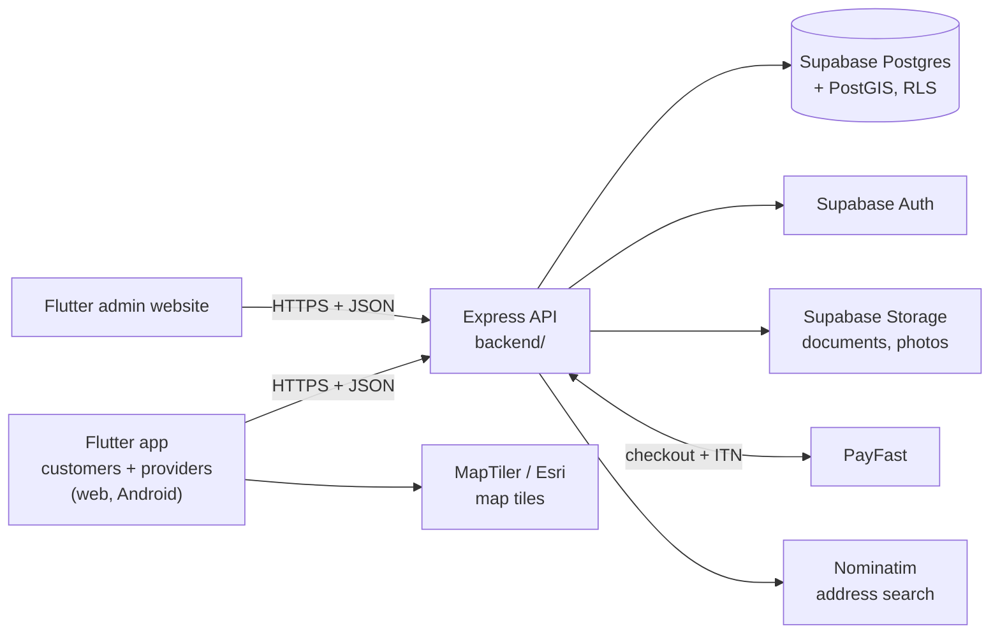

# ConnectLocal

**A South African marketplace that connects customers with verified local service providers.**

[](https://github.com/Katlegomalema/connectlocal/actions/workflows/backend-ci.yml)
[](https://github.com/Katlegomalema/connectlocal/actions/workflows/frontend-ci.yml)
[](LICENSE)

> Final-year BSc Information Technology (Software Engineering) project.

Customers find a nearby plumber, hairdresser, tutor or mechanic, book a time slot and pay a booking fee by card.
Providers apply with their company registration and documents, an admin verifies them, and they get paid
automatically after each job.

---

## Features

**Customers**
- Sign up with "I need a service"; email confirmation and a 6-digit phone code before the first booking
- Search by name or category, see providers on a map with distance, photos, services, prices and reviews
- Book a time slot: visit the business or a house call (address search and "use my location")
- Pay a 15% booking fee by card (PayFast); it counts toward the price and is refunded if the provider declines
- A 4-digit PIN is shown after the provider accepts; the provider enters it on arrival to start the job
- Pay the balance by card or cash, then leave a review; chat with the provider; in-app notifications

**Providers**
- Sign up with "I offer a service", then apply: CIPC registration number (`YYYY/NNNNNN/TT`), ID and company
  documents, business photos and address
- Services priced per hour, as a fixed price or as packages, with photos
- Working hours and slot length (30 minutes to 8 hours); 30 minutes kept free between bookings
- Accept or decline requests, start with the customer's PIN, complete the job
- Bank details stored encrypted (only the last 4 digits are ever shown); automatic payouts minus a 10% commission

**Admin website** (separate app)
- Verify or reject provider applications (documents shown securely)
- Users, bookings, payments, payouts, reported reviews and disputes; analytics

## How it fits together



- The apps only talk to the API (no database keys in the app). Files are uploaded straight to Storage with
  one-time signed URLs.
- The API uses Supabase's service-role key, so it checks ownership and roles itself on every route; Row Level
  Security is on for every table as a second line of defence.
- Times are South African time (SAST). PayFast runs in sandbox mode while testing; a payment can never be charged
  twice (idempotency keys and a single database transaction per PayFast notification).

## Tech stack

| Part | Technology |
|---|---|
| App + admin website | Flutter (Dart), `flutter_map` |
| API | Node.js 22+, Express, zod, pino |
| Database, auth, files | Supabase (PostgreSQL + PostGIS, Auth, Storage) |
| Payments | PayFast (sandbox while testing) |
| Maps | MapTiler (free key) or Esri street map; Nominatim for address search |
| CI | GitHub Actions: lint, tests, both web builds |

## Repository layout

```
backend/                   Express API: routes -> services -> repositories       (backend/README.md)
frontend/connect-local/    Flutter app (lib/main.dart) and admin site (lib/main_admin.dart)
supabase/migrations/       database schema, applied in order with `npm run db:push`
docs/                      requirements, architecture, API specs, project management, proposals
diagrams/                  ERD, use cases, sequence and activity diagrams (Mermaid)
assets/                    branding, wireframes, mockups
START.md                   copy-paste commands to start everything
SETUP.md                   full setup: Codespaces, Android Studio, Netlify, PayFast, email, maps
TEST_REPORT.md             latest full check: what passed, what is still open
```

## Getting started

**Quick start in GitHub Codespaces:** follow [START.md](START.md). First-time setup (Supabase project, `.env`,
admin account, PayFast sandbox, email, maps key): [SETUP.md](SETUP.md).

```bash
# Backend (Node 22+)
cd backend
npm install
cp .env.example .env       # fill in; .env is git-ignored and must never be committed
npm run db:push            # apply the database migrations
npm start                  # http://localhost:3000/health/db

# App and admin website (Flutter)
cd ../frontend/connect-local
flutter pub get
flutter run -d chrome --dart-define=API_BASE_URL=http://localhost:3000
flutter run -d chrome -t lib/main_admin.dart --dart-define=API_BASE_URL=http://localhost:3000
```

Secrets (Supabase service-role key, PayFast merchant key and passphrase, bank-details encryption key) live only in
`backend/.env`. The app only needs `API_BASE_URL` and, optionally, `MAPTILER_KEY` (a public browser key).

## Testing

```bash
cd backend && npm run lint && npm test                 # unit + integration tests
bash scripts/smoke-test.sh                             # whole booking flow with curl against a running API
cd ../frontend/connect-local && flutter analyze && flutter test
```

Latest results: [TEST_REPORT.md](TEST_REPORT.md).

## Team and branches

| Branch | Purpose |
|---|---|
| `main` | Tested, demo-ready code. Changes arrive only through a pull request from `delevop`. |
| `delevop` | Integration branch: everyone's work is merged here first. |
| `feature/...`, `bugfix/...` | Short-lived branches from `delevop` (see [CONTRIBUTING.md](CONTRIBUTING.md)). |


## License

MIT, see [LICENSE](LICENSE).
