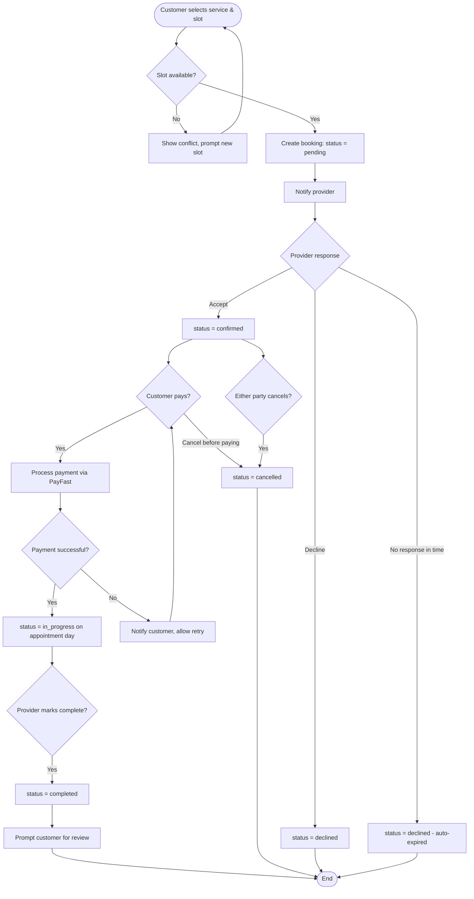

# Activity Diagram: Booking Lifecycle — ConnectLocal

## 1. Introduction
Depicts the flow of activities and decision points a booking passes through from creation to completion or cancellation.

## 2. Purpose
To visualize the booking state machine and its branching logic for developers implementing the Booking Service, and for testers deriving test cases covering each path.

## 3. Scope
Covers the customer- and provider-driven activities governing a single booking's lifecycle.

## 4. Diagram

## 5. Assumptions
- Providers who do not respond to a booking request within a configurable window (e.g., 24 hours) result in an automatic decline to avoid indefinitely pending requests.

## 6. Constraints
- Cancellation activity does not model partial refunds; refund policy application is handled by the Payment Service and Admin dispute process where applicable.

## 7. Future Enhancements
- Add a "Reschedule" branch showing the loop back to `pending` for re-confirmation.
