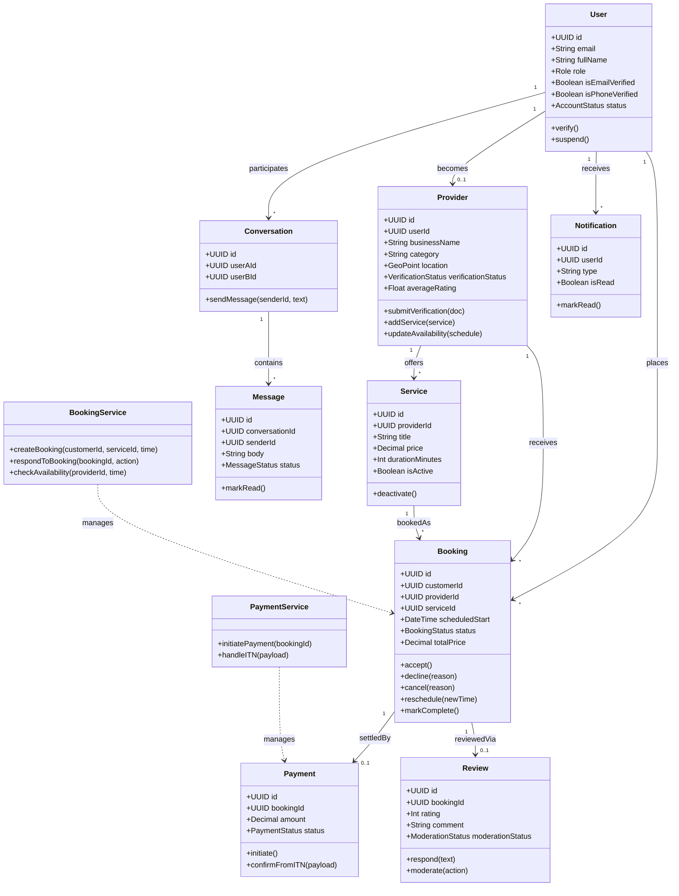

# Class Diagram — ConnectLocal Backend Domain Model

## 1. Introduction
Presents the core domain classes of the ConnectLocal backend service layer and their relationships, independent of persistence or transport concerns.

## 2. Purpose
To guide object-oriented/module design of the service layer described in `Backend-Architecture.md`, ensuring consistent modeling of domain concepts across the codebase.

## 3. Scope
Covers primary domain entities and key service classes. Utility/infrastructure classes (loggers, config loaders) are omitted for clarity.

## 4. Diagram

## 5. Assumptions
- The domain model favors composition and explicit state transitions (methods like `accept()`, `cancel()`) over anemic data classes, aligning with the service-layer pattern in the backend architecture.

## 6. Constraints
- Diagram represents logical domain classes; actual JavaScript implementation uses plain objects and service functions rather than formal classes, per the project's pragmatic Node.js conventions.

## 7. Future Enhancements
- Introduction of a `Dispute` domain class as dispute-handling logic matures beyond simple admin-recorded resolutions.
