# Component Diagram — ConnectLocal

## 1. Introduction
Illustrates the deployable/logical components of ConnectLocal and their dependencies, complementing the System Architecture document.

## 2. Purpose
To show component-level boundaries and interfaces, useful for onboarding new developers and for identifying candidate seams for future service extraction.

## 3. Scope
Covers backend service components and their direct dependencies on data stores and external systems. Frontend component breakdown is documented in the Flutter app's internal folder structure (see `frontend/README.md`).

## 4. Diagram

```mermaid
flowchart TB
    subgraph Backend["ConnectLocal Backend"]
        AuthC[Auth Component]
        UserC[User/Provider Component]
        SearchC[Search Component]
        BookingC[Booking Component]
        MsgC[Messaging Component]
        RevC[Review Component]
        PayC[Payment Component]
        NotifC[Notification Component]
        AdminC[Admin Component]
    end

    subgraph Interfaces["Provided Interfaces"]
        IAuth[["IAuthService"]]
        IBooking[["IBookingService"]]
        IPayment[["IPaymentService"]]
    end

    AuthC -- provides --> IAuth
    BookingC -- provides --> IBooking
    PayC -- provides --> IPayment

    UserC -. depends on .-> IAuth
    BookingC -. depends on .-> IAuth
    BookingC -. depends on .-> IPayment
    PayC -. depends on .-> IBooking
    MsgC -. depends on .-> IAuth
    RevC -. depends on .-> IBooking
    AdminC -. depends on .-> IAuth

    SearchC --> DB[(PostgreSQL/PostGIS)]
    BookingC --> DB
    PayC --> DB
    MsgC --> DB
    RevC --> DB
    NotifC --> DB
    AdminC --> DB

    SearchC --> Maps[Google Maps API]
    PayC --> PayFast[PayFast Gateway]
    NotifC --> FCM[Push Notification Service]
```

## 5. Assumptions
- Components communicate in-process (function calls) within the current modular-monolith architecture rather than over a network protocol.

## 6. Constraints
- Formal interface contracts (`IAuthService`, etc.) are enforced by convention and code review in the current implementation, not by a language-level interface mechanism (plain JavaScript).

## 7. Future Enhancements
- Formalize interfaces via TypeScript if the codebase migrates, enabling compile-time contract verification.
