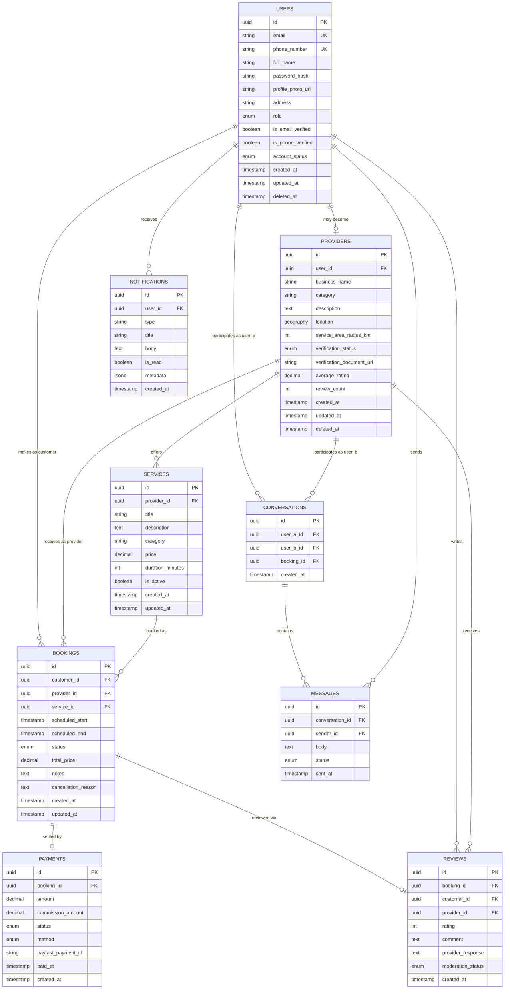

# Entity Relationship Diagram & Schema Documentation — ConnectLocal

## 1. Introduction
This document provides the complete logical database design for ConnectLocal, including the entity relationship diagram, per-table schema definitions, normalization notes, and indexing recommendations. It supports the Database Design phase of the project.

## 2. Purpose
To serve as the authoritative reference for the PostgreSQL schema implemented on Supabase, ensuring consistency between design, migrations, and application code.

## 3. Scope
Covers the eight core entities: Users, Providers, Services, Bookings, Payments, Messages (and Conversations), Reviews, and Notifications, along with their relationships and constraints.

## 4. Entity Relationship Diagram

## 5. Detailed Table Documentation

### 5.1 `users`
| Attribute | Type | Constraint |
|---|---|---|
| id | uuid | PK, default `gen_random_uuid()` |
| email | varchar(255) | UNIQUE, NOT NULL |
| phone_number | varchar(20) | UNIQUE, NULLABLE |
| full_name | varchar(150) | NOT NULL |
| profile_photo_url | text | NULLABLE |
| address | text | NULLABLE |
| role | enum(`customer`,`provider`,`admin`) | NOT NULL, default `customer` |
| is_email_verified | boolean | NOT NULL, default `false` |
| is_phone_verified | boolean | NOT NULL, default `false` |
| account_status | enum(`active`,`suspended`,`deactivated`) | NOT NULL, default `active` |
| created_at / updated_at / deleted_at | timestamptz | NOT NULL / NOT NULL / NULLABLE |

**Relationships:** One-to-one with `providers` (a user may optionally have a provider profile); one-to-many with `bookings` (as customer), `messages`, `notifications`, `reviews`.
**Validation Rules:** Email must match RFC 5322 format; phone number in E.164 format; password managed by Supabase Auth (not stored in this table).

### 5.2 `providers`
| Attribute | Type | Constraint |
|---|---|---|
| id | uuid | PK |
| user_id | uuid | FK → users.id, UNIQUE, NOT NULL |
| business_name | varchar(150) | NOT NULL |
| category | varchar(50) | NOT NULL |
| description | text | NULLABLE |
| location | geography(Point,4326) | NOT NULL |
| service_area_radius_km | int | NOT NULL, default 10, CHECK (1–50) |
| verification_status | enum(`pending`,`approved`,`rejected`) | NOT NULL, default `pending` |
| verification_document_url | text | NULLABLE |
| average_rating | decimal(2,1) | NOT NULL, default 0.0 (denormalized cache) |
| review_count | int | NOT NULL, default 0 (denormalized cache) |
| created_at / updated_at / deleted_at | timestamptz | |

**Relationships:** Belongs to one `user`; has many `services`, `bookings` (as provider), `reviews` (as recipient).
**Validation Rules:** `category` must match a controlled vocabulary managed in admin settings; `location` required before `verification_status` can move to `approved`.

### 5.3 `services`
| Attribute | Type | Constraint |
|---|---|---|
| id | uuid | PK |
| provider_id | uuid | FK → providers.id, NOT NULL |
| title | varchar(150) | NOT NULL |
| description | text | NULLABLE |
| category | varchar(50) | NOT NULL |
| price | decimal(10,2) | NOT NULL, CHECK (price >= 0) |
| duration_minutes | int | NOT NULL, CHECK (duration_minutes > 0) |
| is_active | boolean | NOT NULL, default `true` |
| created_at / updated_at | timestamptz | |

**Relationships:** Belongs to one `provider`; referenced by many `bookings`.

### 5.4 `bookings`
| Attribute | Type | Constraint |
|---|---|---|
| id | uuid | PK |
| customer_id | uuid | FK → users.id, NOT NULL |
| provider_id | uuid | FK → providers.id, NOT NULL |
| service_id | uuid | FK → services.id, NOT NULL |
| scheduled_start | timestamptz | NOT NULL |
| scheduled_end | timestamptz | NOT NULL |
| status | enum(`pending`,`confirmed`,`in_progress`,`completed`,`cancelled`,`declined`) | NOT NULL, default `pending` |
| total_price | decimal(10,2) | NOT NULL |
| notes | text | NULLABLE |
| cancellation_reason | text | NULLABLE |
| created_at / updated_at | timestamptz | |

**Relationships:** Belongs to one `customer` (user), one `provider`, one `service`; has one optional `payment`; has one optional `review`; anchors one `conversation`.
**Validation Rules:** `scheduled_end` must be after `scheduled_start`; overlapping bookings for the same `provider_id` with status in (`pending`,`confirmed`,`in_progress`) are rejected at the application layer via a conflict check query and enforced with a PostgreSQL exclusion constraint on `(provider_id, tstzrange(scheduled_start, scheduled_end))`.

### 5.5 `payments`
| Attribute | Type | Constraint |
|---|---|---|
| id | uuid | PK |
| booking_id | uuid | FK → bookings.id, UNIQUE, NOT NULL |
| amount | decimal(10,2) | NOT NULL |
| commission_amount | decimal(10,2) | NOT NULL, default 0 |
| status | enum(`pending`,`paid`,`failed`,`refunded`) | NOT NULL, default `pending` |
| method | enum(`payfast`) | NOT NULL, default `payfast` |
| payfast_payment_id | varchar(100) | NULLABLE |
| paid_at | timestamptz | NULLABLE |
| created_at | timestamptz | NOT NULL |

**Relationships:** Belongs to exactly one `booking` (1:1).
**Validation Rules:** `status` transitions to `paid` only via a verified PayFast ITN callback; `amount` must equal the booking's `total_price` at initiation.

### 5.6 `conversations` and `messages`
**`conversations`**
| Attribute | Type | Constraint |
|---|---|---|
| id | uuid | PK |
| user_a_id | uuid | FK → users.id, NOT NULL |
| user_b_id | uuid | FK → users.id, NOT NULL |
| booking_id | uuid | FK → bookings.id, NULLABLE |
| created_at | timestamptz | NOT NULL |

**`messages`**
| Attribute | Type | Constraint |
|---|---|---|
| id | uuid | PK |
| conversation_id | uuid | FK → conversations.id, NOT NULL |
| sender_id | uuid | FK → users.id, NOT NULL |
| body | text | NOT NULL, max 2000 chars |
| status | enum(`sent`,`delivered`,`read`) | NOT NULL, default `sent` |
| sent_at | timestamptz | NOT NULL |

**Relationships:** A `conversation` has many `messages`; unique constraint on `(user_a_id, user_b_id, booking_id)` prevents duplicate threads for the same context.

### 5.7 `reviews`
| Attribute | Type | Constraint |
|---|---|---|
| id | uuid | PK |
| booking_id | uuid | FK → bookings.id, UNIQUE, NOT NULL |
| customer_id | uuid | FK → users.id, NOT NULL |
| provider_id | uuid | FK → providers.id, NOT NULL |
| rating | smallint | NOT NULL, CHECK (rating BETWEEN 1 AND 5) |
| comment | varchar(500) | NULLABLE |
| provider_response | varchar(500) | NULLABLE |
| moderation_status | enum(`visible`,`hidden`) | NOT NULL, default `visible` |
| created_at | timestamptz | NOT NULL |

**Relationships:** Belongs to exactly one `booking` (1:1); belongs to one `customer` and one `provider`.
**Validation Rules:** Creation only permitted when the referenced booking's `status = completed`.

### 5.8 `notifications`
| Attribute | Type | Constraint |
|---|---|---|
| id | uuid | PK |
| user_id | uuid | FK → users.id, NOT NULL |
| type | varchar(50) | NOT NULL (e.g., `booking_confirmed`, `new_message`, `payment_received`) |
| title | varchar(150) | NOT NULL |
| body | text | NULLABLE |
| is_read | boolean | NOT NULL, default `false` |
| metadata | jsonb | NULLABLE (e.g., `{ "bookingId": "..." }`) |
| created_at | timestamptz | NOT NULL |

**Relationships:** Belongs to one `user`.

## 6. Normalization Notes
The schema is designed to **Third Normal Form (3NF)** for all transactional entities: every non-key attribute is fully functionally dependent on the primary key, with no transitive dependencies. Two deliberate, documented denormalizations exist:
1. `providers.average_rating` and `providers.review_count` are cached aggregates of the `reviews` table, recalculated via a database trigger (`AFTER INSERT/UPDATE ON reviews`) rather than computed at query time. This trades minor write overhead for significantly cheaper read performance on the high-traffic provider search/browse path.
2. `bookings.total_price` duplicates the service's price at time of booking (rather than joining to `services.price` at read time), preserving historical accuracy if a provider later changes their price.

## 7. Index Recommendations
| Table | Index | Rationale |
|---|---|---|
| providers | GiST index on `location` | Enables efficient `ST_DWithin` radius search |
| providers | btree on `category`, `verification_status` | Search filtering |
| bookings | composite btree on `(provider_id, scheduled_start)` | Availability/conflict checks |
| bookings | btree on `customer_id` | "My bookings" listing |
| bookings | exclusion constraint on `(provider_id, tstzrange(scheduled_start, scheduled_end))` | Prevents double-booking at the database level |
| messages | composite btree on `(conversation_id, sent_at)` | Paginated message history |
| reviews | unique btree on `booking_id` | Enforces one review per booking |
| notifications | composite btree on `(user_id, is_read, created_at)` | Notification center query pattern |

## 8. Assumptions
- All timestamps are stored in UTC (`timestamptz`) and converted to local time in the Flutter client.
- Supabase's PostGIS extension is enabled on the target database instance.

## 9. Constraints
- Soft-delete (`deleted_at`) is implemented on `users`, `providers`, and implicitly `services` (`is_active`) to preserve referential integrity for historical bookings.

## 10. Future Enhancements
- Partitioning `messages` and `notifications` by month as data volume grows.
- Introduction of a `provider_staff` table to support multi-staff provider accounts.
- Materialized view for admin analytics to avoid live aggregation over large tables.
