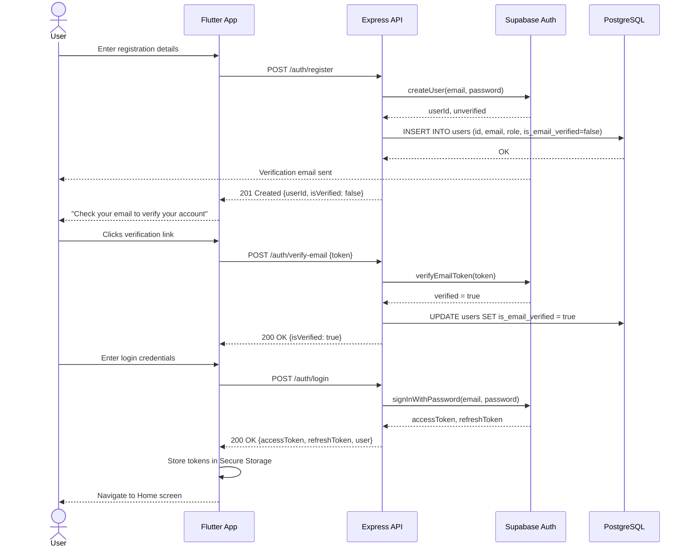

# Sequence Diagram: Authentication Flow — ConnectLocal

## 1. Introduction
Depicts the message sequence for user registration and login, including email verification, across the Flutter client, Express API, and Supabase Auth.

## 2. Purpose
To clarify the exact order of calls and responsibilities between components during authentication, supporting both implementation and test-case design.

## 3. Scope
Covers registration, email verification, and login. Token refresh is a simplified sub-flow of Login and is described narratively.

## 4. Diagram

## 5. Assumptions
- Email verification token delivery and validation is fully handled by Supabase Auth's built-in flow.

## 6. Constraints
- Diagram omits error paths (e.g., invalid credentials, expired token) for clarity; these are covered in `Authentication-API.md` status code tables.

## 7. Future Enhancements
- Extend diagram to include Google OAuth's redirect-based flow once implemented on Web.
