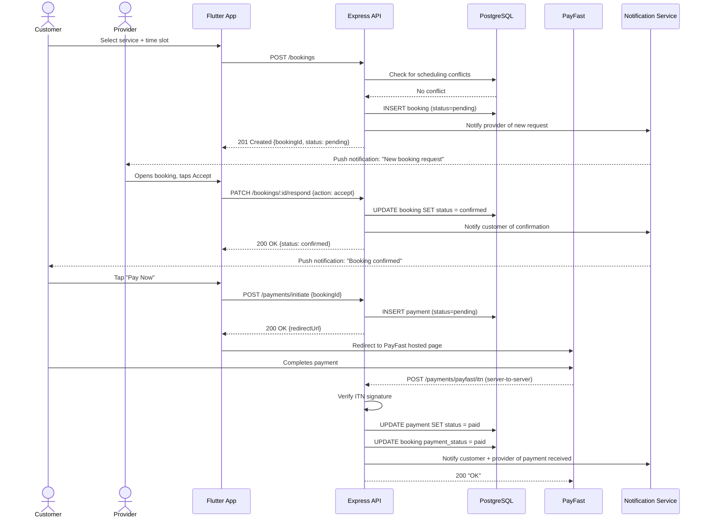

# Sequence Diagram: Booking & Payment Flow — ConnectLocal

## 1. Introduction
Depicts the end-to-end sequence for a customer creating a booking, the provider accepting it, and the customer completing payment via PayFast.

## 2. Purpose
To document the interaction order across client, backend, database, and the PayFast gateway, ensuring shared understanding of the transactional flow prior to implementation.

## 3. Scope
Covers booking creation through payment confirmation. Messaging that may occur alongside this flow is documented separately.

## 4. Diagram

## 5. Assumptions
- PayFast's ITN callback reaches the API reliably; retry/reconciliation handling is documented as a future enhancement.

## 6. Constraints
- Diagram assumes a single service per booking (no multi-service cart in current scope).

## 7. Future Enhancements
- Add a reconciliation sequence for missed/delayed ITN notifications (scheduled job polling PayFast's query API).
