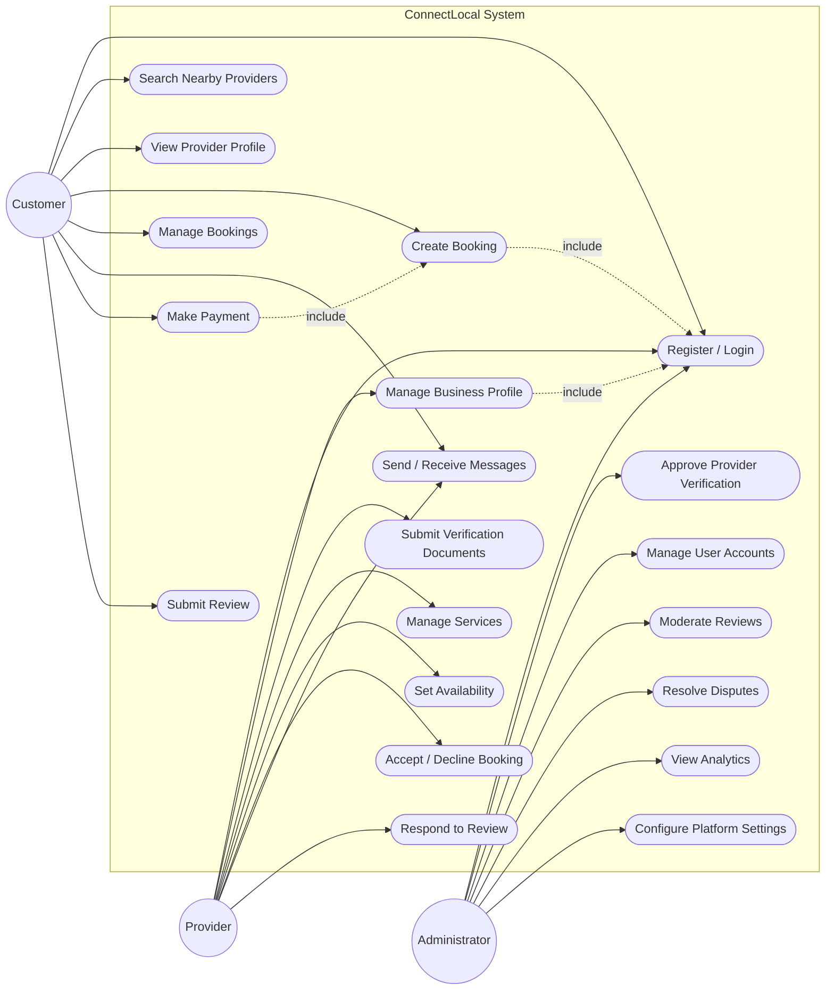

# Use Case Diagram — ConnectLocal

## 1. Introduction
This document presents the system-level use case diagram for ConnectLocal, visualizing the interactions between the Customer, Provider, and Administrator actors and the system's core functions.

## 2. Purpose
To provide a high-level, visual complement to the detailed use case descriptions in `docs/requirements/Use-Cases.md`.

## 3. Scope
Covers all primary use cases across the three actors. Shared/included use cases (e.g., Authentication) are modeled using `<<include>>` relationships.

## 4. Diagram

## 5. Assumptions
- All actor interactions with the system require successful authentication (`UC1`), modeled via `<<include>>` on dependent use cases.

## 6. Constraints
- Diagram scope is limited to primary use cases; exception/error flows are detailed in the corresponding use case descriptions rather than the diagram itself.

## 7. Future Enhancements
- Addition of a "Dispute Escalation" actor interaction as the dispute-resolution process matures.
