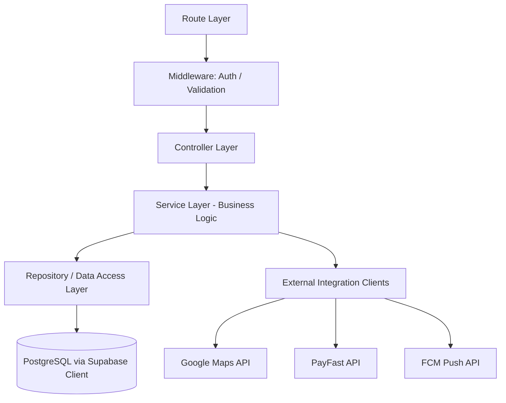

# Backend Architecture — ConnectLocal

## 1. Introduction
This document details the internal architecture of the ConnectLocal Node.js/Express backend, including its layering, folder structure, and cross-cutting concerns.

## 2. Purpose
To guide backend developers on where new code belongs, how requests flow through the system, and how to maintain consistency as the codebase grows.

## 3. Scope
Covers the `backend/` application only. Database schema detail is documented separately in `Database-Architecture.md`.

## 4. Detailed Content

### 4.1 Layered Design



- **Route Layer**: Defines URL paths and HTTP methods, maps to controllers. No logic beyond wiring.
- **Middleware**: JWT verification, request schema validation (Zod/express-validator), rate limiting, error handling.
- **Controller Layer**: Parses request, invokes the relevant service, shapes the HTTP response. Contains no business logic or direct DB access.
- **Service Layer**: Encapsulates business rules (e.g., booking conflict checks, review eligibility). Framework-agnostic and independently unit-testable.
- **Repository Layer**: Encapsulates all Supabase/PostgreSQL queries behind a consistent interface, isolating the rest of the application from query syntax changes.
- **Integration Clients**: Thin wrappers around Google Maps, PayFast, and FCM SDKs/HTTP APIs.

### 4.2 Folder Structure

```
backend/
├── src/
│   ├── config/            # env loading, supabase client init, constants
│   ├── routes/             # express routers per module
│   ├── controllers/        # request/response handling
│   ├── services/            # business logic
│   ├── repositories/        # data access layer
│   ├── middleware/          # auth, validation, error handling
│   ├── integrations/        # google-maps, payfast, fcm clients
│   ├── utils/               # shared helpers (logger, response formatter)
│   ├── validators/          # request schema definitions
│   └── app.js                # express app assembly
├── tests/
│   ├── unit/
│   └── integration/
├── migrations/               # SQL migration files (see Database-Architecture.md)
├── server.js                  # application entry point
├── package.json
└── .env.example
```

### 4.3 Request Lifecycle
1. Client sends an HTTP request with a Bearer JWT (except public endpoints).
2. Express router matches the path/method to a controller.
3. Auth middleware verifies the JWT against Supabase Auth's public key and attaches `req.user`.
4. Validation middleware checks the request body/query against a schema; invalid requests return `400` immediately.
5. Controller invokes the relevant service method.
6. Service applies business rules, calling one or more repositories and/or integration clients.
7. Repository executes the query against PostgreSQL via the Supabase client (or direct `pg` connection for complex queries).
8. Response is shaped by the controller and returned as JSON with a consistent envelope: `{ success, data, error }`.
9. Errors thrown anywhere in the chain are caught by centralized error-handling middleware and mapped to appropriate HTTP status codes.

### 4.4 Cross-Cutting Concerns
- **Logging**: structured JSON logging (e.g., via `pino`) with request correlation IDs.
- **Error Handling**: centralized error middleware distinguishes operational errors (4xx, expected) from programming errors (5xx, unexpected), the latter triggering alerting in production.
- **Rate Limiting**: `express-rate-limit` applied to authentication and payment endpoints to mitigate brute-force/abuse.
- **CORS**: restricted to known frontend origins (Flutter Web build domain, local dev origin).

### 4.5 Technology Justification
Express was selected over alternatives (NestJS, Fastify) for its minimal learning curve given the team's familiarity, its unopinionated structure allowing the layered pattern above to be imposed deliberately, and its maturity/stability for an academic timeline where framework risk should be minimized.

### 4.6 Security Considerations
- All secrets loaded exclusively from environment variables via a single `config/env.js` module — no direct `process.env` access elsewhere.
- Service-role Supabase keys (which bypass RLS) are used **only** in trusted backend contexts, never exposed to the client.
- All monetary calculations (booking totals, commission) are performed server-side; the client never dictates a final price.

## 5. Assumptions
- A single backend service instance is sufficient for the academic demonstration environment.
- The team has working familiarity with Express middleware patterns.

## 6. Constraints
- No TypeScript compilation step in the initial implementation (plain Node.js with JSDoc typing); may be revisited (see Future Enhancements).

## 7. Future Enhancements
- Migration to TypeScript for stronger compile-time type safety.
- Introduction of a dependency-injection container for easier service-layer testing.
- Splitting Booking and Payment modules into separately deployable services.
