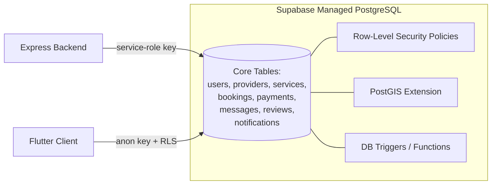

# Database Architecture — ConnectLocal

## 1. Introduction
This document describes the architectural approach to data storage and management for ConnectLocal. Detailed table-level schema is provided in `diagrams/erd/ERD.md`; this document focuses on architectural decisions, access patterns, and operational concerns.

## 2. Purpose
To explain why PostgreSQL via Supabase was chosen, how data access is secured, and how the schema is organized and evolved over time.

## 3. Scope
Covers the production database architecture, migration strategy, and geospatial query approach. Detailed entity attributes are covered in the ERD document.

## 4. Detailed Content

### 4.1 Architecture Overview

### 4.2 Design Principles
- **Third Normal Form (3NF)** baseline for all transactional tables (users, bookings, payments) to eliminate update anomalies; selective denormalization (e.g., cached `average_rating` on `providers`) is applied only where read performance materially benefits and is justified in the Normalization Notes of the ERD document.
- **UUID primary keys** across all tables for global uniqueness, safe client-side ID generation, and compatibility with Supabase Auth's user IDs.
- **Soft deletes** (`deleted_at` timestamp) on user-facing entities (users, providers, services) to preserve referential integrity for historical bookings/reviews while allowing "deletion" from a UX perspective.
- **PostGIS** `geography(Point, 4326)` columns for provider location, enabling efficient radius queries via `ST_DWithin`.

### 4.3 Access Control Strategy
Two access paths exist:
1. **Client → Supabase (anon key)**: used for read-only, non-sensitive queries (e.g., public provider browsing) where Row-Level Security policies are sufficient to enforce authorization directly at the database layer.
2. **Client → Express API → Supabase (service-role key)**: used for all write operations and any read involving business logic (e.g., booking conflict checks, payment processing), where the backend enforces authorization and business rules before touching the database.

This hybrid approach balances development speed (RLS for simple reads) with the correctness guarantees of centralized business logic (backend-mediated writes).

### 4.4 Migration Strategy
- All schema changes are expressed as versioned, timestamped SQL files in `backend/migrations/` (e.g., `20260115_create_bookings_table.sql`).
- Migrations are applied via the Supabase CLI (`supabase migration up`) and run automatically in the deployment pipeline before the new backend version is promoted.
- Rollback scripts accompany every migration that alters or drops existing structures.

### 4.5 Indexing Strategy (Summary)
See ERD document for the full per-table index list. Key indexes:
- GiST index on `providers.location` for geospatial queries.
- Composite index on `bookings(provider_id, scheduled_start, status)` for availability/conflict checks.
- Index on `messages(conversation_id, created_at)` for efficient conversation pagination.
- Unique index on `reviews(booking_id)` to enforce one review per booking.

### 4.6 Security Considerations
- Row-Level Security is enabled on every table; default-deny policies require an explicit policy to permit access.
- The service-role key (which bypasses RLS) is held only in backend environment variables and never shipped to the client.
- Personally identifiable information (PII) — phone numbers, addresses — is restricted to owner-only read access via RLS, with administrative override policies scoped to the `admin` role claim in the JWT.

## 5. Assumptions
- Supabase's managed Postgres includes the PostGIS extension enabled by default (verified during environment setup).
- Query volumes remain within the free/Pro tier connection pool limits during the academic project period.

## 6. Constraints
- Supabase connection pooling (PgBouncer) limits the number of concurrent direct database connections, influencing the backend's use of a connection pool with conservative `max` settings.

## 7. Future Enhancements
- Read replicas for reporting/analytics queries to isolate load from the transactional path.
- Partitioning of the `messages` and `notifications` tables by date range as volume grows.
- Materialized views for admin analytics dashboards to avoid expensive aggregate queries on live tables.
