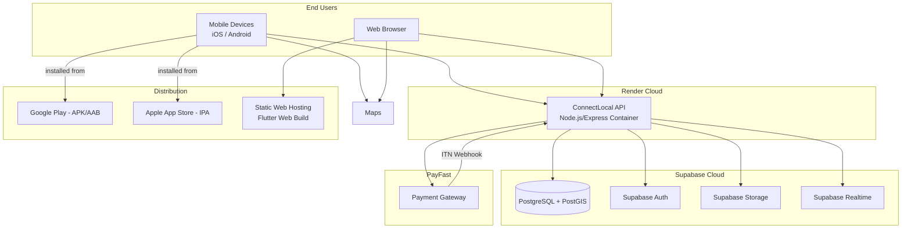
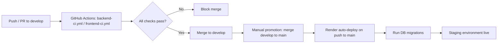

# Deployment Architecture — ConnectLocal

## 1. Introduction
This document describes how ConnectLocal's components are deployed, hosted, and connected in staging and production-like environments.

## 2. Purpose
To provide a clear operational picture of where each component runs, how they communicate, and how deployments are triggered and rolled back.

## 3. Scope
Covers hosting of the backend API, database, authentication, storage, and frontend distribution. Step-by-step deployment instructions are in `docs/deployment/Deployment-Guide.md`.

## 4. Detailed Content

### 4.1 Deployment Diagram

### 4.2 Environment Strategy

| Environment | Purpose | Backend Host | Database |
|---|---|---|---|
| **Local** | Individual developer workstations | `localhost:4000` | Local Supabase CLI instance or shared dev project |
| **Staging** | Integration testing, supervisor/assessor demos | Render (staging service) | Supabase staging project |
| **Production** | Not required for academic scope; documented for future use | Render (production service) | Supabase production project |

### 4.3 CI/CD Pipeline

- Backend deploys automatically on push to `main` via Render's native GitHub integration.
- Database migrations run as a pre-deploy step configured in Render's build command (`npm run migrate && npm start`).
- Frontend web build is deployed to static hosting (e.g., Render Static Site or Firebase Hosting); mobile builds are distributed as debug/internal-testing APKs during the academic project (no app store submission required for assessment).

### 4.4 Security Considerations
- Environment variables/secrets are configured directly in Render's dashboard and Supabase project settings, never committed to the repository.
- PayFast ITN webhook endpoint validates the source IP range and signature before processing.
- HTTPS is enforced end-to-end; Render provisions TLS certificates automatically for the API domain.

## 5. Assumptions
- Render's free/starter tier provides sufficient uptime and resource allocation for staging/demo purposes.
- The team will not require production app store distribution within the academic timeline.

## 6. Constraints
- Render free-tier services may spin down after inactivity, introducing cold-start latency for the first request after idle periods — acceptable for a demo environment, flagged as a known limitation.

## 7. Future Enhancements
- Blue-green or canary deployment strategy for zero-downtime production releases.
- Containerization via Docker for environment parity between local, staging, and production.
- Migration to a dedicated cloud provider (AWS/GCP/Azure) with auto-scaling for a commercial launch.
