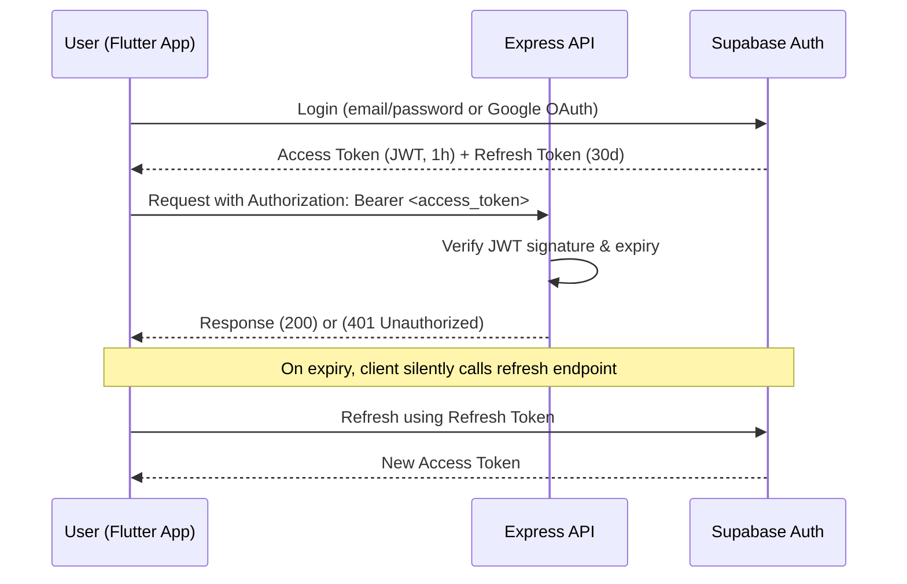

# Security Architecture — ConnectLocal

## 1. Introduction
This document consolidates ConnectLocal's security architecture across authentication, authorization, data protection, and third-party integration concerns, drawing together security considerations distributed across the other architecture documents.

## 2. Purpose
To provide a single reference for the system's threat model and the controls implemented to mitigate identified risks, supporting both development practice and academic assessment of the project's security posture.

## 3. Scope
Covers application-level, data-level, and integration-level security controls. Infrastructure-level security (e.g., Supabase/Render's internal hardening) is inherited from the vendor and referenced but not re-specified here.

## 4. Detailed Content

### 4.1 Authentication & Session Security

- Authentication is delegated entirely to Supabase Auth, avoiding custom password-handling code and its associated risk surface.
- Access tokens are short-lived (1 hour) to limit the blast radius of a leaked token; refresh tokens (30 days) are stored securely on-device using Flutter Secure Storage (Keychain/Keystore-backed).
- Google OAuth uses the standard authorization code flow via Supabase Auth's provider integration.

### 4.2 Authorization Model
- **Role-Based Access Control (RBAC)** with three roles: `customer`, `provider`, `admin`, encoded as a custom claim in the JWT.
- Express middleware (`requireRole(['admin'])`) guards admin-only routes.
- **Row-Level Security (RLS)** policies in PostgreSQL provide defense-in-depth: even if an API bug were to omit an authorization check, the database itself rejects unauthorized row access for client-issued (anon-key) queries.

### 4.3 Data Protection
| Concern | Control |
|---|---|
| Data in transit | TLS 1.2+ enforced on all client-API and API-Supabase connections |
| Data at rest | Supabase-managed PostgreSQL encryption at rest (AES-256, provider-managed) |
| Password storage | Never handled directly by ConnectLocal code; Supabase Auth uses industry-standard hashing (bcrypt) |
| PII exposure | Phone numbers/addresses restricted via RLS to the owning user and admins |
| Payment data | No card data touches ConnectLocal servers; PayFast's hosted payment page handles card capture (PCI-DSS scope minimized) |

### 4.4 Input Validation & Injection Prevention
- All request payloads validated server-side against explicit schemas (reject-by-default for unexpected fields).
- Parameterized queries exclusively — the Supabase client library and any raw SQL use parameter binding, eliminating SQL injection vectors.
- Flutter client sanitizes/escapes any user-generated content rendered as rich text (e.g., review text) to prevent injection into WebViews, if used.

### 4.5 Third-Party Integration Security
- Provider coordinates are written through the authenticated API and queried in PostGIS. The map renderer and tile-provider configuration remain client-side; no map vendor key is required by the backend.
- **PayFast ITN webhook**: validated via (1) source IP allow-listing against PayFast's published IP ranges, (2) signature/MD5 hash verification, and (3) a server-side confirmation POST back to PayFast before trusting the notification, per PayFast's recommended integration pattern.
- **Push notifications (FCM)**: server key stored server-side only; device tokens are scoped per-user and revoked on logout.

### 4.6 Abuse & Rate Limiting
- Rate limiting applied to authentication endpoints (`/auth/login`, `/auth/register`) to mitigate credential-stuffing and brute-force attacks.
- Booking and messaging endpoints are rate-limited per-user to prevent spam/abuse.

### 4.7 Logging & Monitoring
- Authentication failures, authorization denials, and payment anomalies are logged with correlation IDs for later audit.
- No sensitive data (passwords, full card numbers, tokens) is ever written to logs.

## 5. Assumptions
- Supabase and Render's underlying infrastructure security (patching, network isolation) meets industry-standard baselines as managed service providers.
- The academic project scope does not require formal penetration testing, though OWASP Top 10 principles are applied throughout.

## 6. Constraints
- No dedicated security budget; reliance on open-source/free tooling (`npm audit`, `flutter analyze`, manual OWASP-aligned review) for security validation.

## 7. Future Enhancements
- Multi-factor authentication (MFA) for provider and admin accounts.
- Automated dependency vulnerability scanning integrated into CI (e.g., Dependabot, Snyk).
- Formal third-party penetration test prior to any commercial launch.
- Web Application Firewall (WAF) in front of the API for production deployment.
