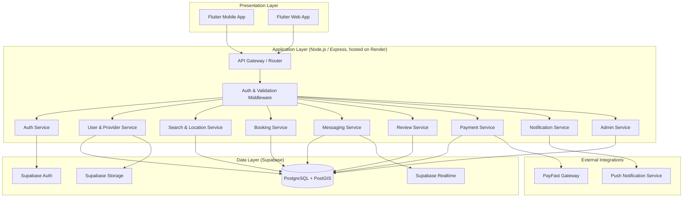

# System Architecture — ConnectLocal

## 1. Introduction
This document describes the overall system architecture of ConnectLocal, covering the major components, their interactions, and the technology choices underpinning the platform. It supports the System Analysis and System Design phases of the project.

## 2. Purpose
To provide a shared architectural reference for developers, testers, and reviewers, ensuring the system is built consistently around a well-understood set of components and integration patterns.

## 3. Scope
Covers the client, API, service, data, and external integration layers of ConnectLocal. Backend-specific and database-specific detail is elaborated further in `Backend-Architecture.md` and `Database-Architecture.md` respectively.

## 4. Detailed Content

### 4.1 Architectural Style
ConnectLocal adopts a **layered, service-oriented architecture** with a clear separation between the presentation layer (Flutter), the application/API layer (Node.js/Express), and the data layer (PostgreSQL via Supabase). This style was chosen over a full microservices approach because:
- The project team size (small, academic) cannot justify the operational overhead of independently deployed microservices.
- A modular monolith with clearly bounded service modules (Auth, Booking, Messaging, Review, Payment, Notification) gives most of the maintainability benefits of service separation while remaining simple to develop, test, and deploy within Render's single-service hosting model.
- Service modules are designed with clear internal boundaries so they could be extracted into independent services in a future production iteration without a full rewrite.

### 4.2 High-Level Component Diagram

### 4.3 Component Descriptions

| Component | Responsibility |
|---|---|
| **API Gateway / Router** | Single entry point for all HTTP requests; routes to the appropriate service module. |
| **Auth & Validation Middleware** | Verifies JWTs issued by Supabase Auth, enforces role-based access, validates request payloads. |
| **Auth Service** | Wraps Supabase Auth flows (register, login, OTP, token refresh, logout). |
| **User & Provider Service** | Manages customer profiles, provider business profiles, and verification workflow. |
| **Search & Location Service** | Executes PostGIS radius queries over provider coordinates supplied by the Flutter client. |
| **Booking Service** | Owns the booking lifecycle state machine and slot-conflict prevention logic. |
| **Messaging Service** | Manages conversation threads and real-time delivery via Supabase Realtime. |
| **Review Service** | Manages review submission, aggregation, and moderation. |
| **Payment Service** | Initiates PayFast payment requests and processes ITN callbacks. |
| **Notification Service** | Dispatches push notifications (FCM) and manages in-app notification records. |
| **Admin Service** | Aggregates cross-cutting administrative operations and analytics queries. |

### 4.4 Technology Justification
- **Flutter**: single codebase for Android, iOS, and Web reduces development effort for a small team while delivering native-like performance.
- **Node.js/Express**: event-driven, non-blocking I/O model suits the read-heavy (search, browse) and real-time (messaging) workloads typical of a marketplace app; large middleware ecosystem accelerates development.
- **PostgreSQL (Supabase)**: strong relational integrity for financial/booking data, native PostGIS extension for efficient geospatial queries, and Supabase bundles Auth/Storage/Realtime, reducing infrastructure to manage.
- **Flutter map rendering + PostGIS**: keeps tile rendering in the client and performs vendor-independent radius search in PostgreSQL.
- **PayFast**: widely supported South African payment gateway with a straightforward server-to-server ITN verification model.
- **Render**: simple, low-cost container hosting with GitHub-integrated CI/CD, appropriate for an academic project budget.

### 4.5 Security Considerations
- All client-to-API traffic is over HTTPS (TLS 1.2+).
- Supabase Row-Level Security (RLS) policies enforce that users can only read/write rows they own or are authorized to access (e.g., a customer cannot read another customer's bookings).
- JWT access tokens are short-lived (1 hour); refresh tokens are used to obtain new access tokens without re-authentication.
- PayFast ITN callbacks are validated using PayFast's signature (MD5 hash) and source IP validation before trusting payment status updates.
- Sensitive configuration (API keys, secrets) is stored in environment variables / Render's secret manager, never committed to source control.
- Input validation occurs at both the Flutter client (UX) and Express API (authoritative) layers.

## 5. Assumptions
- Supabase's managed Postgres instance provides sufficient performance for the expected academic-project traffic volume.
- A single Render web service instance is sufficient for staging/demo purposes; horizontal scaling is a future concern.

## 6. Constraints
- No dedicated DevOps engineer; deployment automation is limited to what GitHub Actions and Render's native GitHub integration provide.
- Real-time messaging relies on Supabase Realtime's connection limits under the current plan tier.

## 7. Future Enhancements
- Extraction of Booking and Payment services into independently deployable services as transaction volume grows.
- Introduction of a message queue (e.g., RabbitMQ or Supabase Edge Functions with pg triggers) for asynchronous notification dispatch.
- API Gateway layer (e.g., Kong) for centralized rate limiting and request logging at production scale.
