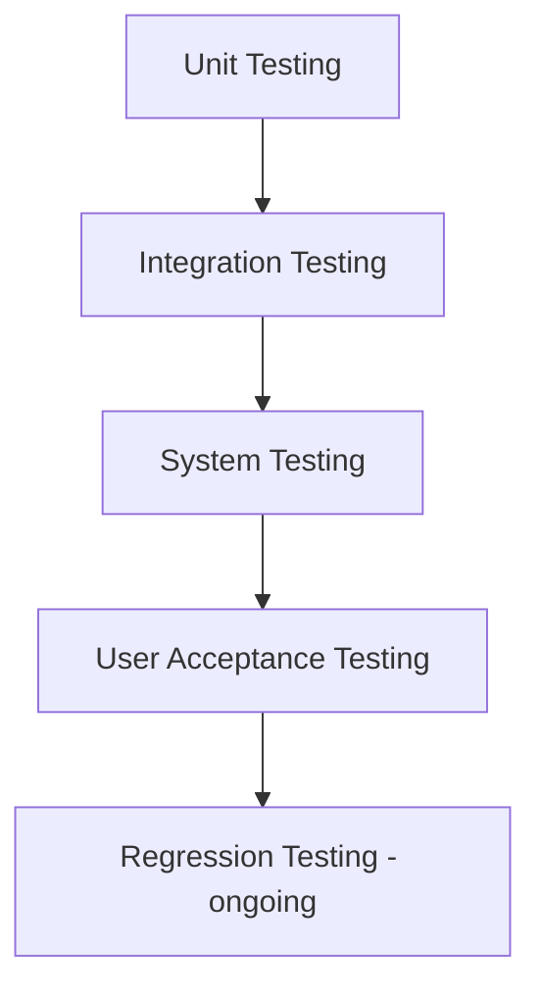

# Test Strategy — ConnectLocal

## 1. Introduction
Defines the overall approach to quality assurance for ConnectLocal, establishing the test levels, tools, environments, and entry/exit criteria applied across the project.

## 2. Purpose
To ensure the delivered system meets its functional and non-functional requirements, with defects identified and resolved before each sprint's Definition of Done is satisfied.

## 3. Scope
Covers unit, integration, system, and user acceptance testing across the Flutter frontend and Node.js/Express backend. Detailed procedures for each level are documented in companion files (`Unit-Testing.md`, `Integration-Testing.md`).

## 4. Detailed Content

### 4.1 Test Levels

| Level | Focus | Tooling | Owner |
|---|---|---|---|
| Unit | Individual functions/service methods in isolation | Jest (backend), `flutter_test` (frontend) | Developers |
| Integration | Interaction between service layer, repositories, and the database/external APIs (mocked) | Jest + Supertest, Supabase test project | Developers + QA |
| System | End-to-end flows across the deployed staging environment | Manual + Postman/Newman collections | QA Engineer |
| User Acceptance Testing (UAT) | Real-world usability and business-rule validation by proxy end users | Manual, scripted scenarios | QA Engineer + Proxy Users |

### 4.2 Test Environments
| Environment | Purpose |
|---|---|
| Local | Developer machine, isolated Supabase dev project, mocked external APIs |
| CI | GitHub Actions runners, ephemeral test database, sandbox third-party credentials |
| Staging | Render + Supabase staging project, sandbox PayFast, real Google Maps API (rate-limited) |

### 4.3 Entry & Exit Criteria
**Entry criteria for System Testing:** All planned features for the milestone merged to `develop`; CI green; no open critical bugs.
**Exit criteria for System Testing:** All planned test cases executed; no open critical/high defects; ≥90% of medium/low defects triaged with a resolution plan.

### 4.4 Defect Severity Classification
| Severity | Definition | Example |
|---|---|---|
| Critical | System unusable / data loss / security breach | Payment double-charges a customer |
| High | Major feature broken, no workaround | Booking creation fails for all users |
| Medium | Feature broken, workaround exists | Search filter doesn't apply, but browsing works |
| Low | Cosmetic / minor inconvenience | Misaligned button on a rarely-used screen |

### 4.5 Test Coverage Targets
- Backend service-layer unit test coverage: ≥ 70%.
- Critical-path integration coverage (auth, booking, payment): 100% of documented API endpoints exercised by at least one integration test.
- All "Must Have" user stories covered by at least one system/UAT test case.

## 5. Assumptions
- CI-run integration tests use a dedicated Supabase test project isolated from staging/production data.

## 6. Constraints
- Load/performance testing is limited by free-tier third-party service quotas; results are indicative rather than production-scale (see Non-Functional-Requirements.md).

## 7. Future Enhancements
- Introduction of automated end-to-end UI testing (e.g., `integration_test` package for Flutter) to reduce manual system-test effort.
- Formal performance/load testing using a tool such as k6 prior to any commercial launch.
